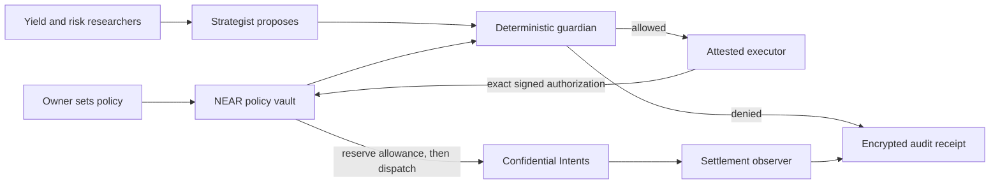

# Neslos — private agents, publicly enforceable limits

**Agents propose. Your policy decides what can spend.**

Neslos is an agent treasury for people who want automated research and payments without giving an agent unrestricted custody. Researchers compare NEAR DeFi opportunities, a strategist proposes an action, and a deterministic guardian checks the owner's rules. A NEAR policy vault enforces a shared spending allowance; the private runtime verifies its TEE before accepting sensitive work.

Built for [NEAR HACKATHON](https://nearhackathon.com/), 1–14 November 2026. Target: **$55,000 grand prize** and Security, Privacy, DeFi and Swarms tracks ($15,000 per track). This project has not been submitted or awarded a prize.

**Verification repeated on 6 November:** 285 application tests, 6 browser tests, 13 contract unit tests and 1 NEAR sandbox suite passed in Ubuntu WSL, with strict TypeScript and production builds. The [foundation audit](docs/AUDIT-2026-11-06.md) repaired five defects, including stale unpause and mismatched transaction recovery. The new vault protection is not yet deployed; the retained public testnet proof covers the older WASM. [Evidence and limits](docs/PROOF.md).

| Start here | What you can inspect |
| --- | --- |
| [Run locally](#run-locally) | No wallet, credentials or funds required |
| [90-second demonstration](docs/DEMO.md) | Overspend → blocked; allowed mission → signed receipt |
| [Verification evidence](docs/PROOF.md) | Commands, measured results and the compiled contract checksum |
| [Architecture](docs/ARCHITECTURE.md) · [Privacy](docs/PRIVACY.md) | Enforcement, trust boundaries and public information |
| [Contract](contracts/policy-vault/README.md) · [Deployment](docs/DEPLOYMENT.md) | Vault interface and provisioning the attested runtime |
| [Local owner workspace](docs/OWNER-WORKSPACE.md) | Private browser controls, credit caps, funding, schedules and journal recovery |
| [TEE runbook and free access](docs/TEE-RUNBOOK.md) | Owner CLI, private research/audit, dstack deployment and verified credit options |
| [Hackathon research](docs/RESEARCH.md) | Official rules, source links, track fit and deadline |

The public testnet vault is [vault.neslos.testnet](https://testnet.nearblocks.io/address/vault.neslos.testnet). [Deployment](deploy/testnet.json) and [proof receipts](deploy/testnet-proof.json) verify a public test-token demonstration. Public hosting, demo video and hardware evidence remain pending; the private path requires provisioning and credentials.

## What we built

Four connected screens turn the policy into an observable workflow:

- **Control room:** mission composer, six execution stages, shared allowance and adversarial demonstrations.
- **Yield research:** Rhea lending data, base/reward APY, exit liquidity, source links and explicit policy exclusions. Broader NEAR discovery uses DeFiLlama when available.
- **Policy vault:** daily and per-action USDC caps, approved venues/counterparties, slippage, research constraints and pause. Editing a policy preserves consumption.
- **Audit trail:** encrypted payloads, signed hash-chain receipts, browser-side verification, export/import and a tampered-copy test.

The agent roles are lending researcher, liquidity researcher, risk researcher, strategist, guardian, executor and settlement observer. Rehearsal research is deterministic. The separate private runtime runs three verified, encrypted NEAR AI research requests; deterministic code retains spending authority.

## Run locally

Install **Node 24.22.2** (minimum 24.22.1) and npm. From this directory:

```sh
npm ci
npm run dev
```

Open **http://127.0.0.1:5173**. API health: http://127.0.0.1:8787/api/health. The default bind is loopback. This Windows workspace also has a verified compatible Node binary which the scripts select automatically.

Try the complete flow:

1. Open **Policy vault**: the default is $500/day, $200/action and 50 bps slippage.
2. In **Control room**, select **Use the reproducible reference dataset** for a stable demonstration.
3. Click **Overspend**. Inspect the failed guardian checks; the allowance stays $500.
4. Launch the default **$150 allocation reserve** mission. Watch research, proposal, guardian, execution and settlement; the remaining allowance becomes $350.
5. In **Audit trail**, click **Verify integrity**, then **Test a tampered copy**. The original passes; the changed copy fails.

Example mission: “Research NEAR stablecoin yields and prepare a reserve for the best eligible opportunity.” Rehearsal records the objective and uses deterministic, policy-based research. In the separate private runtime, the objective is passed to the verified NEAR AI researchers. The structured amount, counterparty and policy determine spending authority.

**An allocation reserve is not a lending deposit.** The rehearsal simulates funds and settlement; it produces real cryptographic receipts, not chain transactions or hardware attestations. The on-chain contract is exercised separately in the local NEAR sandbox and public testnet.

For the compiled local application:

```sh
npm run verify
npm start
```

Then open http://127.0.0.1:8787.

## How it works



In the private path, the owner verifies fresh TDX evidence before HPKE-encrypting a request. The enclave verifies private commitment openings, obtains encrypted NEAR AI research, checks a signed confidential quote, and prepares a NEAR FunctionCall. The owner or an authorized relayer submits it. The contract independently checks integer limits and the exact signature before transferring the fixed budget token. A settlement observation never causes a second deposit.

## The policy, enforced

| Attempt | Enforcement |
| --- | --- |
| Spend more than the daily/per-action cap | Exact u128 USDC arithmetic; shared allowance reserved before external dispatch |
| Race several agents or replay an authorization | One monotonic contract nonce; atomic reservation; request idempotency |
| Edit a policy to replenish today's allowance | Policy version changes; existing usage and nonce remain |
| Substitute a recipient, venue, asset or deposit address | Exact Borsh signature binding, commitment membership and output-asset allowlist |
| Use public routing under a confidential policy | Guardian rejection, signed confidential-recipient routing and contract confidentiality check |
| Exceed the slippage cap | Ceiling-rounded integer minimum output, bounded by the signed quote |
| Forge failure or treat a timeout as a refund | Private FT callback; only a failed receipt restores its original UTC day's allowance |
| Alter an audit receipt | AES-GCM, Ed25519 and ordered hashes; independent verification against a retained checkpoint |

The on-chain vault can check private commitment membership, but opening those commitments and binding the hidden recipient to the quote are responsibilities of the pinned TEE. Slippage is measured against the signed quote, not an independent fair-value oracle.

## Integrations and their evidence

| Surface | Implementation and current evidence |
| --- | --- |
| Rhea Finance | Live `/list_token_data` queries; 18 raw markets in the captured response, 10 supported by the normalizer. Explicitly dated fallback; no fabricated upstream observation timestamp. |
| DeFiLlama | Additional NEAR protocol discovery. These rows are research-only until liquidity and execution are verified. |
| NEAR policy vault | Rust/near-sdk WASM executed in a local sandbox and deployed on public testnet; downloaded code hashes, finalized receipts, spending limits and test-token balances verified. |
| Confidential Intents / 1Click | Official token discovery and quote-signature verifier. Requires signed `CONFIDENTIAL_INTENTS` routing. The live confidential quote probe returned **HTTP 401 without a JWT**; no successful live quote is claimed. |
| Intel TDX / dstack | DCAP verification, pinned MRTD/RTMR measurements, debug rejection, fresh nonce and signing/transport-key binding. Real hardware has not been provisioned here. |
| NEAR AI | E2EE, pinned gateway/model deployment, strict TCB checks, GPU evidence and explicit provider response verification. Encrypted structured reviews affect strategy, with durable credit limits and no duplicate paid retry. The API key passed validation; genuine live TEE inference remains unverified. |
| External paid agents | Separate owner-operated x402/USDC adapter with local budget and settlement tests. It is outside the vault and TEE; no live paid job is claimed. [Scope](docs/COMMERCE.md). |

“Best yield” means the leading eligible opportunity among queried markets. Ranking uses base APY plus 25% of reward APY, with explicit bridge/utilization penalties; it is a transparent heuristic, not a return prediction. Rates and available liquidity can change.

## Reproduce the checks

```sh
npm run verify
npx playwright install chromium
npm run test:browser
npm run research -- --reference
```

Contract checks require Rust **1.93.0**, the `wasm32-unknown-unknown` target, and **cargo-near 0.22.0**. On Windows, install those inside WSL Ubuntu.

```sh
cargo install cargo-near --version 0.22.0 --locked
npm run test:contract
```

The wrapper builds both contracts and starts a local NEAR sandbox. It exercises valid transfers, replay and signature failures, owner policy changes, failed dispatch, private callback protection, settlement records, pause and recovery. No mainnet account is touched. See [deployment instructions](docs/DEPLOYMENT.md) for platform details and the separate TEE process.

## Limitations and disclosures

- The default browser application is a **rehearsal** with isolated, memory-only sessions. The separate local **owner workspace** (`npm run owner`) reads finalized chain state and operates an independently configured private runtime. Its live cloud integration remains unverified; browser tests use labelled fixtures.
- Sensitive production computation is designed for an attested runtime. Public NEAR deposits, amounts, policy fields, output minima and timing remain visible. A public lending position stays public.
- The 1Click provider sees routing fields. Neslos does not independently attest that HTTPS endpoint. Provider settlement status is an observation, not an independent destination-chain proof.
- The private runtime prepares payments and allocation-reserve funding. The private owner CLI verifies the returned call, prints a reviewable plan, and can submit that exact plan with durable transaction recovery. It also operates private research/audit and owner policy/pause/recovery. The public testnet demonstration remains a separate fixture-token proof. The owner dashboard also supports token registration/funding plans and finite research/settlement-observation schedules. Schedules never submit transactions. Neither flow opens a lending position.
- Spending limits cover the fixed USDC token and UTC calendar days. NEAR gas/storage, inference and TEE hosting have separate budgets. Unknown/late-refund outcomes remain charged.
- Real TEE deployment, live encrypted inference and funded Intents settlement are unverified. Local application/browser checks and the TEE container build pass; GitHub CI records pushed revisions separately. [STATUS](docs/STATUS.md) records the tested revision and remaining work.
- This is an AI-assisted hackathon implementation, not an independently audited custody product. [Security notes](SECURITY.md) include the known transitive dependency advisory. No yield or prize result is guaranteed.

Built from the official NEAR contract scaffold and the libraries pinned in the npm and Cargo lockfiles. The bundled Inter font retains its OFL license. See [research](docs/RESEARCH.md) for source provenance and [MIT license](LICENSE) for project code.
