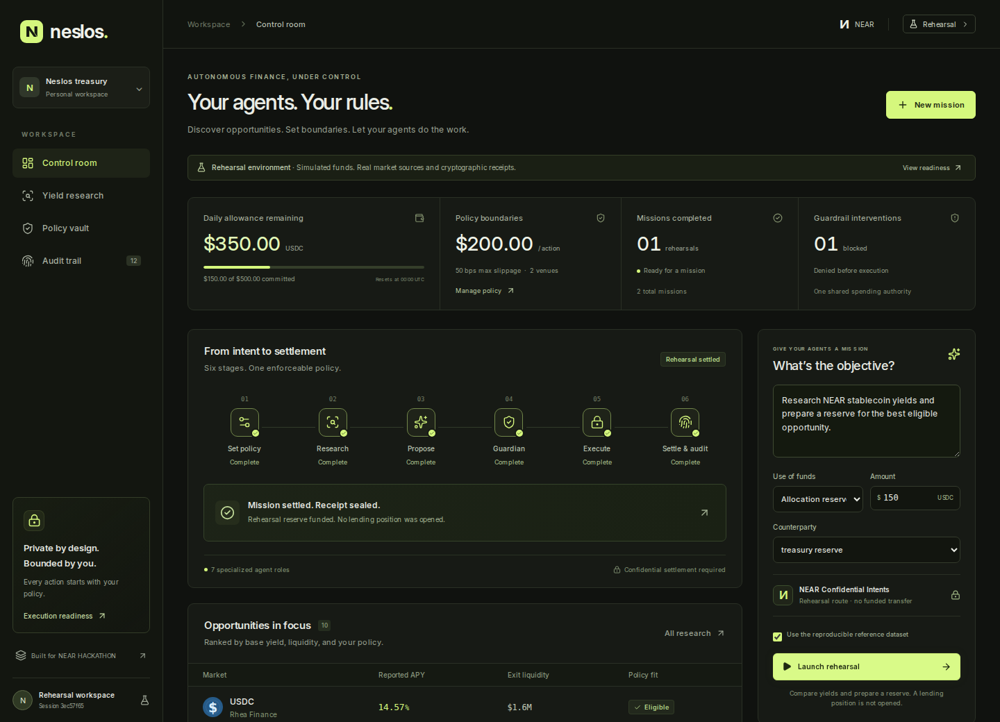
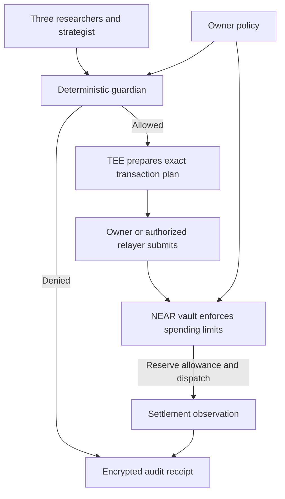

# Neslos

[](https://github.com/Agozie180/Neslos/actions/workflows/verify.yml) · **NEAR HACKATHON:** Security · Privacy · DeFi · Swarms

**Private agent research. Spending limits enforced on NEAR.**

Neslos is an agent treasury for people who want help researching opportunities and preparing payments while keeping control of their funds. Three researchers assess lending, liquidity and risk; a strategist proposes an action; a deterministic guardian checks the owner's policy. The NEAR vault enforces the spending limit before funds leave custody.

**Agents propose. Your policy decides.**

[Try the live demo](https://neslos.vercel.app) · [Track fit](#hackathon-tracks) · [Run locally](#run-locally) · [Inspect the evidence](#what-has-been-verified) · [Current status](docs/STATUS.md) · [Read the architecture](docs/ARCHITECTURE.md)

**For judges:** start with the [competition package](docs/SUBMISSION.md). This checkout adds a **Boundary challenge** that runs a rejected $501 proposal, an allowed $150 reserve and browser receipt/tamper verification, plus an **Evidence room** with direct vault/Rhea receipts and dated private-research results. Run it locally below or use the hosted rehearsal; the [current status](docs/STATUS.md) records the 12 November hosted findings and the fixes prepared in this checkout.



*The public demo is a rehearsal: simulated funds, deterministic research and real cryptographic audit receipts. This screenshot uses the labelled reference dataset. Public vault enforcement, private AI research and the funded public Rhea cycle have separate verification records below.*

## Hackathon tracks

| Track | How Neslos fits | Evidence |
| --- | --- | --- |
| **Security** | Neslos constrains agent spending with on-chain budget enforcement, signed authorizations and replay protection in its NEAR vault. | [Testnet enforcement and adversarial proof](docs/VAULT-COMMERCE-DEPLOYMENT-2026-11-06.md) |
| **Privacy** | Neslos protects research with attested TDX and encrypted inference, and separately demonstrates an owner-wallet Confidential Intents round trip. | [Private research](docs/NEAR-PRIVATE-RESEARCH-2026-11-09.md) · [Settlement with fee-cap failure disclosed](docs/CONFIDENTIAL-SETTLEMENT-2026-11-09.md) |
| **DeFi** | Neslos analyzes live Rhea lending markets for yield, liquidity and risk to produce allocation proposals governed by the owner's treasury policy. | [Live market research](docs/NEAR-PRIVATE-RESEARCH-2026-11-09.md) · [Ranking rules](src/core/research.ts) · [funded owner-wallet Rhea cycle](docs/RHEA-TESTNET-VALIDATION-2026-11-12.md) |
| **Swarms** | Neslos coordinates three specialist researchers, a strategist and a deterministic guardian under one shared treasury policy, with research findings able to veto or narrow a proposal. | [Three signed researcher reports](docs/NEAR-PRIVATE-RESEARCH-2026-11-09.md) · [Strategy constraints](src/core/strategy.ts) |

## Try it in 90 seconds

Open **[neslos.vercel.app](https://neslos.vercel.app)**. No wallet, API key or funds are required.

1. **Inspect the rules.** In **Policy vault**, the default limits are $500/day, $200/action and 50 bps slippage, with approved venues and recipients.
2. **Make the result repeatable.** Return to **Control room** and select **Use the reproducible reference dataset**.
3. **Try to overspend.** Click **Overspend**. The guardian rejects the proposal and the allowance stays at $500.
4. **Run an allowed mission.** Launch the default **$150 allocation reserve**. Follow research, proposal, guardian, execution and settlement; the remaining allowance becomes $350.
5. **Check the evidence.** Open **Audit trail**, select **Verify integrity**, then **Test a tampered copy**. The original verifies; the altered copy fails.

The reference market capture is dated **1 November 2026**. A reserve in this demo simulates earmarking funds; it does not open a lending position. [Full demo script](docs/DEMO.md) · [Audit screenshot](artifacts/neslos-audit.png) · [Mobile screenshot](artifacts/neslos-mobile.png)

### Guided challenge in this checkout

After `npm run dev`, open **http://127.0.0.1:5173/#challenge** and choose **Start the challenge**. This explicitly resets only the simulated workspace, pins the fresh session's audit identity and uses the reference dataset. Follow **Run the $150 mission**, then **Verify & tamper-test receipts**. The challenge checks actual API outcomes and browser cryptography before showing a pass. An uncertain start response reuses its original request ID to recover the mission.

Open **Evidence room** to inspect the separate real vault-testnet, funded Rhea and archived TDX evidence, including the failed native fee-cap result. Download the challenge proof to retain its pinned key, starting checkpoint and original audit history. The evidence index contains selected archived public fields and links; it does not verify private prompts or create a new attestation. [Recording instructions and submission copy](docs/SUBMISSION.md).

## What has been verified

Results below include proofs through **12 November 2026**, with the contract's public commerce proof dated **6 November**. Each claim links to the environment and evidence that support it.

| Claim | Evidence | Scope |
| --- | --- | --- |
| The browser workflow runs and rejects policy violations | [Browser tests](tests/e2e/control-room.spec.ts), three passing production tests and retained [verification record](docs/PROOF.md) | Desktop/mobile rehearsal, policy changes, successful mission and audit tamper detection; simulated funds |
| Spending rules execute on NEAR | [Public vault](https://testnet.nearblocks.io/address/vault.neslos.testnet), [commerce proof](docs/VAULT-COMMERCE-DEPLOYMENT-2026-11-06.md) and [transaction record](deploy/testnet-commerce-proof-20261106.json) | Real testnet receipts, fixture-token balances, limit/replay rejection and preserved state across upgrades |
| A funded Rhea supply/withdrawal cycle executes | [Root-cause audit and validation](docs/RHEA-TESTNET-VALIDATION-2026-11-12.md) and [sanitized record](deploy/rhea-funded-cycle-20261112/record.json) | `neslos.testnet` supplied 0.1 Rhea-listed fake USDC, created shares and recovered full principal; public owner-wallet testnet proof, not vault or TDX execution |
| Three private AI researchers completed inside verified Intel TDX | [Research report](docs/NEAR-PRIVATE-RESEARCH-2026-11-09.md), [result](deploy/near-private-research-20261109/research-proof.json) and [checksum index](deploy/near-private-research-20261109/record.json) | Signed NEAR AI reports covering two live markets; encrypted audit, wrong-owner rejection, replay, restart persistence and exhausted-budget rejection |
| A funded Confidential Intents round trip returned its full principal | [Settlement report](docs/CONFIDENTIAL-SETTLEMENT-2026-11-09.md) and [evidence](deploy/confidential-settlement-20261109/record.json) | 0.001 native NEAR entered an owner-controlled private balance and returned to the same wallet; finalized return receipt verified. Native charges were 0.0071149895375 NEAR, exceeding the stated 0.004 NEAR cap |
| Application, contract and container checks pass | [Current pushed CI run for `6c5c97c`](https://github.com/Agozie180/Neslos/actions/runs/43080014909), [workflow](.github/workflows/verify.yml) and [retained Linux checks](deploy/near-private-research-20261109/local-checks.json) | Application and contract jobs passed for the pushed revision. The current local lending changes additionally passed 642 application tests with five platform skips, TypeScript and the production web build; the focused lending/commerce suite passed 31 tests natively in Ubuntu WSL |

The private research run used encrypted NEAR AI inference, fresh Intel/NVIDIA verification, independently reproduced boot measurements and exact TLS/signer/instance pins. Its reviewed policy explicitly trusts NEAR's administration of routing, runtime and model weights. Loaded weight bytes are not independently proved. The [public archive](deploy/near-private-research-20261109/record.json) contains hardware/build evidence and sanitized results; private prompts and receipt openings remain with the owner. Their hashes identify retained bytes but do not disclose or independently verify the private contents.

**The TDX verification session is complete.** Its temporary server was deleted after the proof to stop hosting charges, and the testnet vault was restored to its original policy and executor, paused at version 13. Reviewing the demo, source, tests and archived evidence does not require renting another TDX instance. [Deployment and cost](#deployment-and-cost) · [Current status](docs/STATUS.md)

## How spending authority works

The models can reject an opportunity or narrow a selection. They cannot increase a limit, expand an allowlist, change the owner policy or sign with the owner's key. The vault checks the exact authorization and reserves the shared allowance before dispatch, so multiple agents compete within one spending policy.



This is the implemented execution design. The public demo rehearses its stages. Public vault transfers, private TDX research, the public owner-wallet Rhea cycle and the owner-wallet Confidential Intents round trip have separate evidence. A funded payment through the complete TDX-to-mainnet-vault path and vault-custodied Rhea execution remain unproved.

| Attempt | Enforced behavior | Inspect |
| --- | --- | --- |
| Overspend, race agents or replay a payment | Integer token limits, shared allowance reservation and one monotonic contract nonce | [Vault](contracts/policy-vault/src/lib.rs) · [Policy tests](tests/policy.test.ts) |
| Edit the policy to replenish today's allowance | Policy version changes while consumption and nonce remain | [Contract specification](contracts/policy-vault/README.md) |
| Substitute the recipient, venue, asset or deposit address | Exact signature binding, commitment membership and output allowlist checks | [Wire format](src/core/wire.ts) · [Binding tests](tests/wire.test.ts) |
| Request a public route under a confidential policy | Guardian and vault reject incompatible routing | [Guardian](src/core/policy.ts) · [Commerce tests](tests/commerce.test.ts) |
| Treat a timeout as a refund or resend a payment | Unknown outcomes retain their charge; recovery checks the saved request or transaction hash | [Transaction recovery](src/owner/transactions.ts) · [Recovery tests](tests/private-transactions.test.ts) |
| Alter a receipt or omit retained history | AES-GCM, Ed25519 and linked hashes verify against an independently retained checkpoint | [Browser verifier](src/web/verify.ts) · [Audit tests](tests/audit-client.test.ts) |

NEAR provides the contract-enforced spending boundary, testnet execution and the private inference service. Rhea supplies lending data and the public lending venue used by the funded testnet cycle; DeFiLlama adds protocol discovery. The confidential payment adapter uses NEAR Intents/1Click. React, TypeScript and Vite provide the interface; Rust/near-sdk implements the vault; Intel TDX/dstack protects the private runtime.

Research ranks eligible opportunities using base APY plus 25% of reward APY, with explicit bridge and utilization penalties. It cites liquidity and exclusions. “Best” means highest under that rule among queried markets; rates and exit liquidity can change. [Research implementation](src/core/research.ts) · [Privacy boundaries](docs/PRIVACY.md)

## Run locally

Use **Node 24.22.2** (minimum 24.22.1) and npm. Versions are recorded in [.node-version](.node-version) and [package-lock.json](package-lock.json).

```sh
git clone https://github.com/Agozie180/Neslos.git
cd Neslos
npm ci
npm run dev
```

Open **http://127.0.0.1:5173**. API health is at **http://127.0.0.1:8787/api/health** and reports `mode: "rehearsal"`, `realFunds: false`. A fresh checkout needs no `.env`, wallet, provider account or paid inference. Select the reference dataset for a repeatable demo without live market access.

For the compiled local application:

```sh
npm run verify
npm start
```

Then open **http://127.0.0.1:8787**. The default server binds to loopback. Local rehearsal sessions are memory-only and reset when their server expires or restarts; the Vercel entry uses temporary Runtime Cache restoration across function instances.

## Reproduce the checks

After `npm ci`, run:

```sh
npm run verify
npx playwright install chromium
npm run test:browser
npm run research -- --reference
```

`verify` runs the application tests, TypeScript checks and production web/server builds. The browser suite covers the public rehearsal and the local owner UI with labelled fixtures. On Linux, install Chromium's system dependencies with `npx playwright install --with-deps chromium` if needed. Linux-specific SDK/tooling tests run in Ubuntu CI; Windows skips those checks. The table above cites CI for pushed revision `6c5c97c`; current uncommitted changes have local Windows and focused Ubuntu WSL results only. The retained private-research archive separately records 638 tests at its earlier revision. Test counts identify their recorded run, not every platform or future revision.

Contract checks require **Rust 1.93.0**, the **wasm32-unknown-unknown** target and **cargo-near 0.22.0**. Use Linux or Ubuntu WSL on Windows; [setup instructions](docs/DEPLOYMENT.md#local-near-proof) include system dependencies.

```sh
cargo install cargo-near --version 0.22.0 --locked
npm run test:contract
```

The wrapper builds the vault and fixture contracts, runs Rust unit tests and starts local NEAR sandboxes. It checks actual receipts, balances, signatures, replay, governance, failed dispatch, callbacks, settlement records and recovery. These commands use local test assets and do not provision paid hosting or submit mainnet transactions.

New verification reports appear under `artifacts/`. Dated, committed deployment evidence lives under `deploy/`; the [verification record](docs/PROOF.md) explains provenance and historical results. [All test commands](package.json) · [CI workflow](.github/workflows/verify.yml)

## Deployment and cost

| Surface | Operating model |
| --- | --- |
| Public Vercel demo | Available at [neslos.vercel.app](https://neslos.vercel.app); independent of the private TDX service |
| Local rehearsal and automated checks | Run on the reviewer's machine or CI with no paid inference or TDX deployment |
| Public testnet vault | Deployed at `vault.neslos.testnet`; original policy/executor restored and spending paused after verification |
| Public Rhea testnet position | `neslos.testnet` completed and withdrew a bounded fake-USDC position; full principal returned, leaving only sub-atomic protocol dust |
| Private TDX runtime | Temporary, metered verification sessions. The completed 9 November instance is retired to control cost; evidence remains available in the repository |

Continuous TDX hosting is outside this demonstration's operating plan. Another live private run is optional and requires a finite hosting window, fresh attestation, reviewed provider policy and an explicit inference allowance. The [TEE runbook](docs/TEE-RUNBOOK.md) documents that process. Historical reservations total **$0.31449624** within the approved **$3 combined cap**: $0.303900 hosting and $0.01059624 inference. These are conservative reservations, not a reconciled provider bill. [Current accounting](docs/STATUS.md) · [Research-stage costs](docs/NEAR-PRIVATE-RESEARCH-2026-11-09.md#testnet-restoration-and-cost)

The local [owner workspace](docs/OWNER-WORKSPACE.md) provides policy review, funding plans, private research, audit and recovery. Owner signing keys stay on the owner's machine. Its finite schedules perform research or settlement observation; transaction submission remains a separate reviewed action.

## Scope and next steps

- **Funded integrations:** a public owner-wallet Rhea testnet cycle supplied and withdrew 0.1 fake USDC with full principal returned. The owner-wallet Confidential Intents round trip also returned full principal but failed its native fee cap. Private research, vault enforcement, Rhea lending and confidential settlement remain separate proofs rather than one bound private-vault transaction. [Rhea validation](docs/RHEA-TESTNET-VALIDATION-2026-11-12.md) · [Integrated review](docs/INTEGRATED-PAYMENT-REVIEW-2026-11-12.md).
- **Owner browser:** a fresh 12 November TDX session passed real owner-browser executor verification, credit inspection, browser-side audit verification, private receipt opening and reload recovery with zero inference calls. The temporary instance was deleted after validation. [Live validation](docs/OWNER-BROWSER-VALIDATION-2026-11-12.md).
- **Agent Market:** new paid jobs are disabled because its wallet-delegate payment rail would bypass the vault. A compatible payment integration is required before claiming agent commerce.
- **Privacy and accounting:** public deposits, amounts, policy fields and timing remain visible. The TEE binds private commitment openings to routes; provider status is an observation rather than an independent destination-chain proof. Slippage is bounded against the signed quote. Principal limits cover one fixed token; gas/storage, inference and hosting have separate budgets.
- **Production hardening:** independent model-weight measurement, a tested fix for the documented transitive dependency advisory and an external security audit remain beyond the completed proof. [Security notes](SECURITY.md) · [Full trust model](docs/PRIVACY.md)

## Documentation

| Guide | Purpose |
| --- | --- |
| [Current status](docs/STATUS.md) · [Verification record](docs/PROOF.md) | Completed work, exact evidence and remaining scope |
| [Architecture](docs/ARCHITECTURE.md) · [Vault specification](contracts/policy-vault/README.md) | Components, trust boundaries and contract invariants |
| [Owner workspace](docs/OWNER-WORKSPACE.md) · [Commerce](docs/COMMERCE.md) | Local controls, funding, schedules and transaction recovery |
| [Deployment](docs/DEPLOYMENT.md) · [TEE runbook](docs/TEE-RUNBOOK.md) | Reproduction, optional private sessions and budget controls |
| [Demo script](docs/DEMO.md) · [Hackathon research](docs/RESEARCH.md) | Walkthrough, official requirements and submission preparation |
| [Judge-safe Rhea reproduction](docs/JUDGE-RHEA-REPRODUCTION.md) | Credential-free receipt verification without changing testnet state |
| [Competition package](docs/SUBMISSION.md) | Guided judge route, narration, submission text, questions and release gates |

Built for [NEAR HACKATHON](https://nearhackathon.com/), 1–14 November 2026. The [four track statements](#hackathon-tracks) link each claim to evidence; publication, the human's demo post and final submission are tracked in the [submission checklist](docs/DEMO.md#submission-preparation).

Neslos is an AI-assisted implementation built from the official NEAR contract scaffold and the libraries pinned in its npm/Cargo lockfiles. Project code is [MIT licensed](LICENSE); the bundled Inter font retains its OFL license. [Source acknowledgements](docs/RESEARCH.md#sources-studied)
