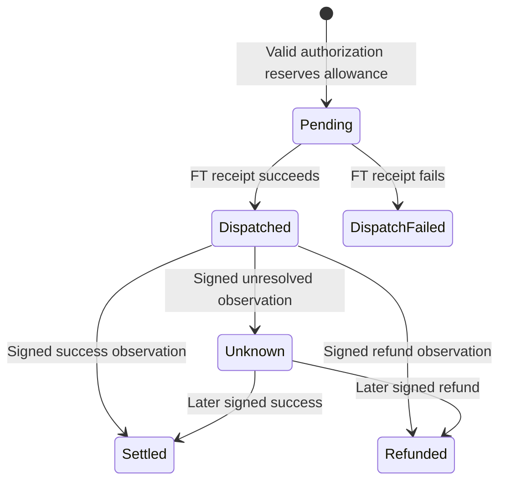

# Neslos policy vault

The spending authority for Neslos agents. The vault holds one fixed fungible token and accepts an exact authorization signed by the owner's pinned executor key. It reserves the shared allowance before creating an external transfer receipt.

**Verified on 1 November 2026:** 12 Rust unit tests and one integration suite deploying the compiled WASM into a local NEAR sandbox. This is not a deployed testnet/mainnet address. See [the verification record](../../docs/PROOF.md).

## Build and test

From the repository root, with Rust 1.93.0, `wasm32-unknown-unknown` and cargo-near 0.22.0 installed:

```sh
npm run build:contract
npm run test:contract:unit
npm run test:contract
```

On Windows these commands use WSL Ubuntu (`NESLOS_WSL_DISTRO` can select another distribution). The complete test builds the vault and the **local-only test token**, then runs real NEAR sandbox receipts. Outputs are in `artifacts/`. The tested build uses `non-reproducible-wasm`; no byte-identical Docker build is claimed.

## Policy and authority

| Field | Meaning |
| --- | --- |
| `daily_limit`, `per_action_limit` | Positive decimal-string u128 token units; USDC has six decimals |
| `max_slippage_bps` | Maximum 0–1,000 bps against signed quoted output |
| `max_quote_age_ms` | 5,000–300,000 milliseconds |
| `venue_commitments` | 1–32 distinct salted venue commitments |
| `counterparty_commitments` | 1–32 distinct salted recipient commitments |
| `output_assets` | 1–16 permitted destination asset identifiers |
| `require_confidential` | Require the authorization's confidential route |
| `paused` | Stop new agent authorizations |

Initialize atomically with deployment using `new(owner_id, token_id, network, executor_public_key, policy)`. The owner and fixed funding token cannot be changed through this interface. `network` is `mainnet` or `testnet` and is signed into every authorization. The executor public key is 32-byte lowercase hex, obtained from independently verified hardware evidence.

The owner retains governance/full-access keys outside the agent. Pinning a key alone does not prove a TEE: [attestation verification and deployment](../../docs/DEPLOYMENT.md) are separate prerequisites.

## Methods

| Method | Caller and effect |
| --- | --- |
| `get_config()` | Read owner, token, network, executor key, policy and version |
| `get_budget()` | Read current UTC day's usage, remaining allowance, version and nonce |
| `get_record(nonce)` | Read the authorization/quote hashes, amount, day, audit hash and status |
| `set_policy(policy, expected_version)` | Owner only; compare-and-swap update; preserves usage and nonce |
| `set_executor_key(public_key, expected_version)` | Owner only; rotate an independently verified executor key |
| `set_paused(paused)` | Owner only; change pause and increment policy version |
| `authorize(authorization, signature)` | Any relayer; valid executor signature required; reserves allowance and dispatches the fixed FT |
| `on_dispatch(nonce)` | Private callback only; records the actual FT receipt result |
| `record_settlement(settlement, signature)` | Any relayer; pinned observer signature and valid state transition required |
| `withdraw_owner(amount)` | Owner only, while paused; transfers the fixed FT back to the owner |
| `ft_on_transfer(sender_id, amount, msg)` | Accepts only the configured token; returns other tokens to sender |

`authorize` needs **at least 0.01 NEAR** for bounded record storage and **80 Tgas**; the client prepares 100 Tgas. The FT transfer attaches one yoctoNEAR. `withdraw_owner` needs exactly one yoctoNEAR. These NEAR costs are separate from the USDC allowance. Register FT storage before funding the vault or its destination.

## Signing protocol

The field order in [Authorization](src/lib.rs) is the protocol:

```text
signature = Ed25519.sign(SHA256(Borsh(authorization)), executor_private_key)
```

The signed fields bind the domain, network, vault, policy version, nonce, input amount, quoted/minimum output, slippage, quote time/expiry, venue/strategy/recipient commitments, deposit account, output asset, quote hash, privacy, action and audit hash. `action=0` is a private payment; `action=1` funds an allocation reserve. There is no arbitrary-call or lending-position adapter.

[TypeScript wire encoding](../../src/core/wire.ts) and Rust assert the same fixed authorization digest:

```text
5bbf40ba5577220ae67679f9977f3aff7b205ea2961a13724e040b80237731db
```

Use the shared encoder rather than manually reordering JSON. U128/U64 JSON values are decimal strings; their Borsh representation is fixed-width little-endian integer bytes.

## Failure and settlement semantics



A failed FT receipt restores **only the original day's** usage and never rewinds the nonce. An oversized successful return is still successful. A timeout, unknown outcome or late provider refund does not replenish allowance. Policy changes, pause and key rotation preserve usage.

Settlement evidence comes from the pinned observer. NEAR does not independently verify a destination-chain payment in this contract. The private recipient and venue commitment openings, and their relationship to the provider's deposit address, are checked by the TEE. Those hidden semantics cannot be inferred from the public commitment alone.

Public chain data includes amounts, nonces, asset/minimum-output fields, commitments and timestamps. See [privacy boundaries](../../docs/PRIVACY.md). The contract has not had an independent security audit.
