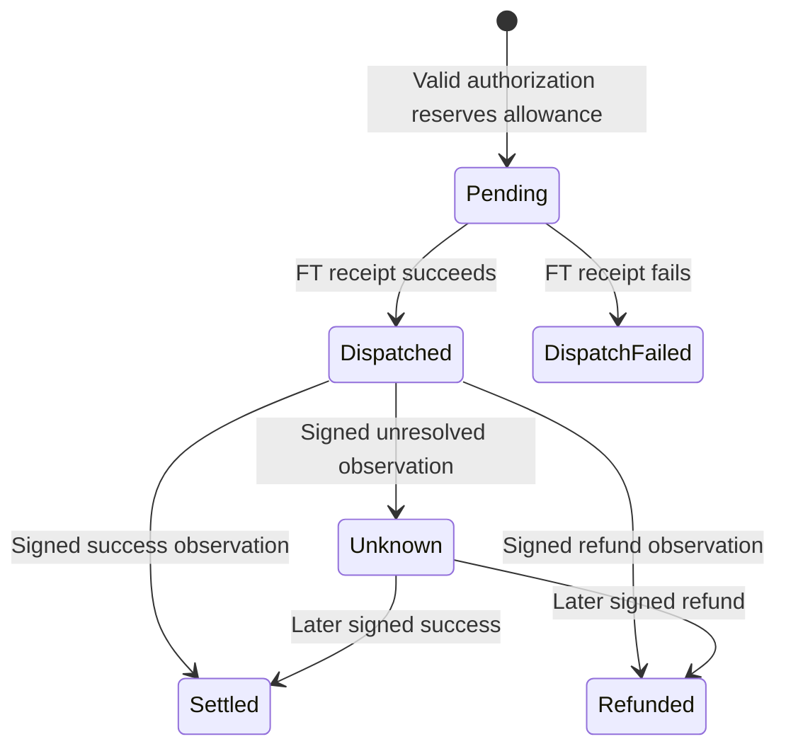

# Neslos policy vault

The spending authority for Neslos agents. The vault holds one fixed fungible token and accepts an exact authorization signed by the owner's pinned executor key. It reserves the shared allowance before creating an external transfer receipt.

The separate `execute_commerce_v1` method lets the owner dispatch constrained public commerce from vault custody. It shares the private path's daily usage and nonce, and always rejects a policy that requires confidential settlement. This is public owner authority, not attested autonomous execution.

**Verified on 6 November 2026:** 25 Rust unit tests and two integration suites deploying the compiled WASM into local NEAR sandboxes. The committed [deployment and commerce proof](../../docs/VAULT-COMMERCE-DEPLOYMENT-2026-11-06.md) records the deployed WASM hash and public testnet receipts. Both jobs also passed for application revision `3aadd7e` in the [9 November CI run](https://github.com/Agozie180/Neslos/actions/runs/42678794686). Local runs generate `artifacts/contract-verification.json`; that output is not committed. These tests use fixture assets and do not establish funded Rhea or TEE execution.

## Build and test

From the repository root, with Rust 1.93.0, `wasm32-unknown-unknown` and cargo-near 0.22.0 installed:

```sh
npm run build:contract
npm run test:contract:unit
npm run test:contract
```

On Windows these commands use WSL Ubuntu (`NESLOS_WSL_DISTRO` can select another distribution). The complete test builds the vault and the **local-only test token**, then runs real NEAR sandbox receipts. Outputs are in `artifacts/`. The tested build uses `non-reproducible-wasm`; no byte-identical Docker build is claimed.

## Policy and authority

| Field | Meaning |
| --- | --- |
| `daily_limit`, `per_action_limit` | Positive decimal-string u128 token units; USDC has six decimals |
| `max_slippage_bps` | Maximum 0–1,000 bps against signed quoted output |
| `max_quote_age_ms` | 5,000–300,000 milliseconds |
| `venue_commitments` | 1–32 distinct salted venue commitments |
| `counterparty_commitments` | 1–32 distinct salted recipient commitments |
| `output_assets` | 1–16 permitted destination asset identifiers |
| `require_confidential` | Require the authorization's confidential route |
| `paused` | Stop new agent authorizations |

Initialize atomically with deployment using `new(owner_id, token_id, network, executor_public_key, policy)`. The owner and fixed funding token cannot be changed through this interface. `network` is `mainnet` or `testnet` and is signed into every authorization. The executor public key is 32-byte lowercase hex, obtained from independently verified hardware evidence.

The owner retains governance/full-access keys outside the agent. Pinning a key alone does not prove a TEE: [attestation verification and deployment](../../docs/DEPLOYMENT.md) are separate prerequisites.

## Methods

| Method | Caller and effect |
| --- | --- |
| `get_config()` | Read owner, token, network, executor key, policy and version |
| `get_budget()` | Read current UTC day's usage, remaining allowance, version and nonce |
| `get_record(nonce)` | Read the authorization/quote hashes, amount, day, audit hash and status |
| `set_policy(policy, expected_version)` | Owner only; compare-and-swap update; preserves usage and nonce |
| `set_executor_key(public_key, expected_version)` | Owner only; rotate an independently verified executor key |
| `set_paused(paused, expected_version?)` | Owner only; resume requires the current version; emergency pause is unconditional; increment policy version |
| `authorize(authorization, signature)` | Any relayer; valid executor signature required; reserves allowance and dispatches the fixed FT |
| `execute_commerce_v1(request)` | Owner only; checks public allowlist openings, reserves shared allowance, then dispatches a fixed payment or Rhea action |
| `on_commerce_preflight_v1(request)` | Private callback; verifies Rhea metadata/account and current policy before dispatch |
| `on_commerce_dispatch_v1(nonce, action)` | Private callback; records bounded public dispatch observations |
| `on_dispatch(nonce)` | Private callback only; records the actual FT receipt result |
| `record_settlement(settlement, signature)` | Any relayer; pinned observer signature and valid state transition required |
| `withdraw_owner(amount)` | Owner only, while paused; transfers the fixed FT back to the owner |
| `ft_on_transfer(sender_id, amount, msg)` | Accepts only the configured token; returns other tokens to sender |

`authorize` needs **at least 0.01 NEAR** for bounded record storage and **80 Tgas**; the client prepares 100 Tgas. The FT transfer attaches one yoctoNEAR. `withdraw_owner` needs exactly one yoctoNEAR. These NEAR costs are separate from the USDC allowance. Register FT storage before funding the vault or its destination.

## Signing protocol

The field order in [Authorization](src/lib.rs) is the protocol:

```text
signature = Ed25519.sign(SHA256(Borsh(authorization)), executor_private_key)
```

The signed fields bind the domain, network, vault, policy version, nonce, input amount, quoted/minimum output, slippage, quote time/expiry, venue/strategy/recipient commitments, deposit account, output asset, quote hash, privacy, action and audit hash. Within this original authorization format, `action=0` is a private payment and `action=1` funds an allocation reserve. Public lending uses the separate method below; the signing format is unchanged.

[TypeScript wire encoding](../../src/core/wire.ts) and Rust assert the same fixed authorization digest:

```text
5bbf40ba5577220ae67679f9977f3aff7b205ea2961a13724e040b80237731db
```

Use the shared encoder rather than manually reordering JSON. U128/U64 JSON values are decimal strings; their Borsh representation is fixed-width little-endian integer bytes.

## Public commerce v1

`execute_commerce_v1({request})` needs 300 Tgas and at least 0.01 NEAR. Only the configured owner may call it. Its request fields, in Borsh order, are:

```text
domain, network, vault, policy_version:U64, nonce:U64, action:u8,
amount:U128, target, venue, venue_salt, counterparty_salt,
quoted_at_ms:U64, expires_at_ms:U64, quote_hash, audit_hash
```

All other fields are strings. `domain` is `neslos:commerce:v1`; `target` and `vault` are NEAR account IDs. Salt/hash values are 64 lowercase hex characters. `amount` is the fixed vault token's base-unit amount. Venue and counterparty commitments are recomputed on-chain using the canonical JSON encoding in `src/core/crypto.ts`; the counterparty value is exactly `target`. The output policy must permit `nep141:<vault-token>`.

- `action=0`: fixed-token `ft_transfer` to the opened target, with no memo or arbitrary message. This does not implement the Agent Market x402 rail, which currently requires an owner-wallet signed delegate.
- `action=1`: fixed-token `ft_transfer_call` to the network's hardcoded Rhea account with an empty message. The public venue must open `rhea`.
- `action=2`: one Rhea `Withdraw` action for the fixed token, with `max_amount` derived from the authorized base units and Rhea's `extra_decimals`. The protocol sends withdrawals to the caller, which is the vault. No debt, collateral or arbitrary action is accepted.

Rhea preflight reads `get_asset` and `get_account`. It checks token identity, bounded decimals, arithmetic overflow, deposit/withdraw enablement, the reported supply cap and absence of reported borrowing. It rechecks pause, confidentiality, policy version, quote age, expiry and the original UTC reservation day before scheduling the spend. These reads do not freeze the external protocol against later governance/state changes.

Every action, including withdrawal, consumes the same daily and per-action allowance. A withdrawal never replenishes prior spending. A proven pre-dispatch rejection or failed direct FT payment restores only its original UTC day's usage. A supply refund, partial use, malformed result or failed protocol dispatch keeps its reservation; callbacks never infer nonpayment from a failed parent receipt that may have successful children.

`Dispatched` establishes only the accepted dispatch result. Rhea's published `execute` schedules token transfer receipts separately; a successful parent receipt does not prove a completed withdrawal. Position shares and the exact FT receipt must be observed separately. Supply/withdrawal tests use a clearly labeled sandbox behavior fixture, not deployed Rhea or real yield. Protocol sources: [official SDK](https://github.com/rhea-finance/burrow-sdk-python), [published supply logic](https://github.com/NearDeFi/burrowland/blob/main/contract/src/fungible_token.rs), [published withdrawal logic](https://github.com/NearDeFi/burrowland/blob/main/contract/src/actions.rs). The older published Rust source is not asserted byte-identical to current deployed Rhea.

The `Vault`, `Policy`, `Record` and status serialization layouts are unchanged. Existing vaults with a retained full-access key can deploy this WASM in place, signing as the vault account without calling `new` or a migration. Verify the key and deployed state first; the owner account's parent name alone does not grant upgrade authority.

The compatibility regression loads [an actual public snapshot of the original testnet vault](tests/fixtures/deployed-v1-state.json), bound to its old code hash at the same finalized block. It preserves version 5, nonce 2, paused policy, both historical records and the original day's 150,000,000 used units.

## Failure and settlement semantics



A failed FT receipt restores **only the original day's** usage and never rewinds the nonce. An oversized successful return is still successful. A timeout, unknown outcome or late provider refund does not replenish allowance. Policy changes, pause and key rotation preserve usage.

Resuming with `set_paused(false, expected_version)` compares the reviewed version on chain. Missing or stale versions fail before mutation, so an older resume cannot undo a newer pause or policy change. Emergency `set_paused(true)` still works without a version, including when a supplied version is stale. Existing deployments need the updated WASM to enforce this resume check.

Settlement evidence comes from the pinned observer. NEAR does not independently verify a destination-chain payment in this contract. The private recipient and venue commitment openings, and their relationship to the provider's deposit address, are checked by the TEE. Those hidden semantics cannot be inferred from the public commitment alone.

Public chain data includes amounts, nonces, asset/minimum-output fields, commitments and timestamps. See [privacy boundaries](../../docs/PRIVACY.md). The contract has not had an independent security audit.
