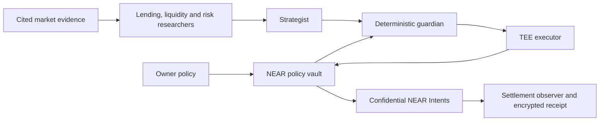

# Neslos: implementation blueprint

**Thesis: agents propose; an exact, policy-bound authorization is the only way to spend.**

Written 1 November 2026 after reading the complete official HACKATHON.md and the local Hackathon-Winning Playbook. This is a new NEAR HACKATHON implementation.

## User flow

Set a USDC policy → research NEAR yields → propose a use of funds → deterministic guardian → attested execution → settlement observation → encrypted audit receipt.

The first demo pays an approved research counterparty or funds an allocation reserve after comparing real yields. **A funded reserve is not a lending deposit.** Public DeFi positions stay public; a strict private policy refuses public lending actions.

## Trust boundaries

- **Owner:** alone changes policy, pauses the vault, and pins the executor key after independent hardware verification. Full access keys never enter agent prompts.
- **Research agents and models:** untrusted. They select and explain evidence; they cannot invent balances, change policy, choose arbitrary contracts or sign transfers.
- **NEAR vault:** holds one spending asset and validates exact amounts, UTC budget, per-action cap, policy version, nonce, expiry, signature, allowed venue/counterparty commitments, slippage and pause state before dispatch. No generic arbitrary-call interface.
- **TEE:** private strategy, recipient openings, quote validation, inference and signing run in the enclave. Missing or invalid hardware evidence blocks the live path. A Docker container, socket, or self-reported verified flag is not attestation.
- **NEAR AI:** use E2EE, gateway/model verification and explicit response-signature verification. Reject anonymised models and unsupported evidence in the private path.
- **Confidential Intents:** hides internal linkage, not public deposit/withdrawal timing or public lending positions. The pinned TEE is trusted to bind a private recipient to its commitment and actual quote. On-chain budget checks alone cannot prove a hidden recipient's identity.

## Invariants

1. Amounts are integer USDC base units (six decimals). No floating point or model-generated arithmetic in spending checks.
2. Updating policy never resets today's usage or the monotonic nonce.
3. Reserve before dispatch. Concurrent agents cannot reuse remaining allowance.
4. Reusing an idempotency key for a changed payload fails; replayed authorizations fail.
5. Unknown settlement stays spent. Never resend money because an HTTP request timed out.
6. A failed FT dispatch releases allowance only against its original UTC day. A later settlement refund does not replenish the day's budget automatically.
7. Submitted, dispatched, settled, refunded and unknown are distinct outcomes.
8. Authorizations bind the contract/network domain, policy version, exact amount, minimum output, recipient commitment, venue, deposit address, quote, privacy mode and expiry.
9. Counterparty commitments are salted. Receipts use authenticated encryption, signatures and a hash chain.
10. A hash chain proves integrity against a retained checkpoint, not completeness against a malicious server that can replace the whole history.
11. Rehearsal receipts contain no fake transaction hashes or hardware attestations.

## Stack and priorities

React + Vite control room; TypeScript policy/research/orchestration/API; Rust near-sdk vault created with the official cargo-near scaffold. Pinned Node 24.22.2 supports the published NEAR AI inference SDK.

P0: adversarial policy tests, real cited yields, separate researchers, complete rehearsal flow, encrypted verifiable receipts and a usable responsive interface.

P1: compiled Rust vault and local chain tests; real dry confidential quotes; TDX verification adapter, pinned inference integration and deployment configuration.

P2: owner-reviewed testnet deployment, independently pinned TEE identity and explicitly authorized funded mainnet settlement.

Finite research and settlement-observation schedules are implemented in the local owner server. They retain request IDs, pause on failure, share the runtime inference allowance and never submit transactions. [Owner architecture and operation](OWNER-WORKSPACE.md).

P3 remaining: funded lending validation and additional budget assets. The [public owner-commerce client](COMMERCE.md) now routes principal through the vault's on-chain limits; it does not execute inside the TEE and rejects confidential policies. Agent Market payment remains disabled because its documented wallet-delegate rail does not support vault funding.

Non-goals: custom cryptography, token/bridge/lending protocol development, arbitrary agent contract calls, hidden public DeFi positions, guaranteed returns or guaranteed awards.

## Demo (90 seconds)

Set a $500/day cap and $200/action cap with 50 bps slippage. Researchers compare NEAR markets and cite sources. Try an overspend or an unapproved recipient: the guardian blocks it without consuming allowance. Run an allowed private-payment rehearsal, inspect distinct execution and settlement steps, verify the sealed receipt and review contract evidence. Show live deployment readiness honestly.
