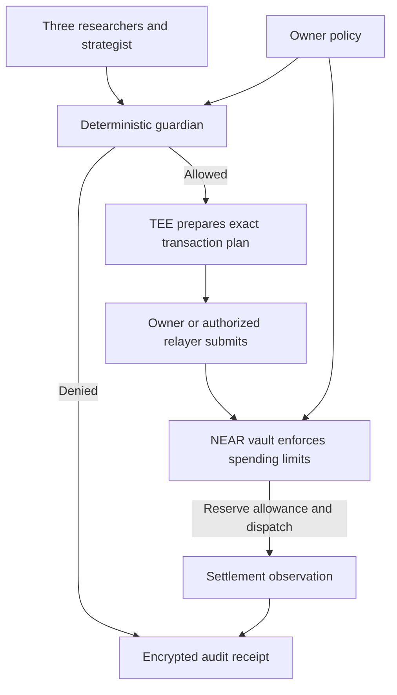

# Neslos architecture

**Thesis: agents propose; an exact, policy-bound authorization is the only way to spend.**

Updated 12 November 2026. The public rehearsal, public testnet vault, public owner-wallet Rhea cycle and private TDX runtime have separate operating environments and verification records. [Current status](STATUS.md) identifies completed proofs and remaining integrations; [PROOF](PROOF.md) links to the recorded revisions and receipts.

## User flow

Set a USDC policy → research NEAR yields → propose a use of funds → deterministic guardian → attested execution → settlement observation → encrypted audit receipt.

The diagram describes the implemented private payment design. The public demo rehearses its stages using simulated funds. Public vault commerce, private TDX research, a funded public owner-wallet Rhea cycle and a funded owner-wallet Confidential Intents round trip have separate evidence. The [Rhea cycle](RHEA-TESTNET-VALIDATION-2026-11-12.md) used a listed fake test asset and no vault/TEE. The [Confidential Intents round trip](CONFIDENTIAL-SETTLEMENT-2026-11-09.md) returned full principal but failed its native fee cap and also used no vault/TEE. The complete funded private-vault path remains unproved. An allocation reserve does not open a lending position. Public DeFi positions stay public; a strict confidential policy refuses public lending actions.

## Trust boundaries

- **Owner:** alone changes policy, pauses the vault, and pins the executor key after independent hardware verification. Full access keys never enter agent prompts.
- **Research agents and models:** untrusted. They select and explain evidence; they cannot invent balances, change policy, choose arbitrary contracts or sign transfers.
- **NEAR vault:** holds one spending asset and validates exact amounts, UTC budget, per-action cap, policy version, nonce, expiry, signature, allowed venue/counterparty commitments, slippage and pause state before dispatch. No generic arbitrary-call interface.
- **TEE:** private strategy, recipient openings, quote validation, inference and signing run in the enclave. Missing or invalid hardware evidence blocks the live path. A Docker container, socket, or self-reported verified flag is not attestation.
- **NEAR AI:** use E2EE/OHTTP, fresh gateway/model hardware verification and explicit response-signature verification. The completed direct integration also pins TLS, signer and instance identity and reviews source/build/deployment history. Provider administration of effective routing, runtime and loaded model weights remains an explicit trust assumption; the weight bytes are not independently measured. Reject anonymised models and unsupported evidence in the private path.
- **Confidential Intents:** hides internal linkage, not public deposit/withdrawal timing or public lending positions. The pinned TEE is trusted to bind a private recipient to its commitment and actual quote. On-chain budget checks alone cannot prove a hidden recipient's identity.

## Invariants

1. Amounts are integer USDC base units (six decimals). No floating point or model-generated arithmetic in spending checks.
2. Updating policy never resets today's usage or the monotonic nonce.
3. Reserve before dispatch. Concurrent agents cannot reuse remaining allowance.
4. Reusing an idempotency key for a changed payload fails; replayed authorizations fail.
5. Unknown settlement stays spent. Never resend money because an HTTP request timed out.
6. A failed FT dispatch releases allowance only against its original UTC day. A later settlement refund does not replenish the day's budget automatically.
7. Submitted, dispatched, settled, refunded and unknown are distinct outcomes.
8. Authorizations bind the contract/network domain, policy version, exact amount, minimum output, recipient commitment, venue, deposit address, quote, privacy mode and expiry.
9. Counterparty commitments are salted. Receipts use authenticated encryption, signatures and a hash chain.
10. A hash chain proves integrity against a retained checkpoint, not completeness against a malicious server that can replace the whole history.
11. Rehearsal receipts contain no fake transaction hashes or hardware attestations.

## Components and verification

React + Vite control room; TypeScript policy/research/orchestration/API; Rust near-sdk vault created with the official cargo-near scaffold. Pinned Node 24.22.2 supports the published NEAR AI inference SDK.

| Component | Responsibility | Verification |
| --- | --- | --- |
| [Web application](../src/web) and [rehearsal API](../src/server/app.ts) | Mission stages, policy controls, research and browser audit verification | Live Vercel rehearsal, desktop/mobile browser checks and simulated funds |
| [Guardian](../src/core/policy.ts) and [strategy](../src/core/strategy.ts) | Deterministic eligibility, limits and proposal checks | Adversarial policy, concurrency and research tests |
| [NEAR vault](../contracts/policy-vault) | Fixed-token custody, shared allowance, exact authorization and constrained dispatch | 25 Rust unit tests, two local sandbox suites and public testnet commerce receipts |
| [Private runtime](../src/tee/runtime.ts) and [inference](../src/core/inference.ts) | Attested encrypted commands, independent researchers and signed audit | Three signed NEAR AI reports inside verified TDX; audit, replay, restart and exhausted-budget checks |
| [Owner workspace](../src/owner/workspace.ts) | Local keys, exact transaction review, funding, recovery and finite schedules | Client/CLI live proof and automated owner-browser fixture tests |
| [Intents adapter](../src/core/intents.ts) | Signed confidential quotes and settlement observation | Credentialed quotes plus a separate funded owner-wallet provider proof; integrated TDX/vault settlement remains separate validation |

Finite research and settlement-observation schedules are implemented in the local owner server. They retain request IDs, pause on failure, share the runtime inference allowance and never submit transactions. [Owner architecture and operation](OWNER-WORKSPACE.md).

The [public owner-commerce client](COMMERCE.md) routes principal through the vault's on-chain limits; it executes through owner authority and rejects confidential policies. The historical testnet vault is fixed to a minimal fixture token and is not a Rhea-compatible deployment; preflight now reports that directly. A separate funded owner-wallet cycle with Rhea-listed fake USDC proved supply, share creation, withdrawal and principal return. [Validation](RHEA-TESTNET-VALIDATION-2026-11-12.md). It does not establish vault-custodied lending. Agent Market payment remains disabled because its documented wallet-delegate rail does not support vault funding.

## Runtime lifecycle and cost

The public rehearsal and local tests run independently of a private TDX service. Private verification uses a temporary, metered CPU CVM with a finite hosting window and a separately bounded inference allowance. The completed 9 November session was retired after research/audit/restart verification to stop hosting charges. The owner retained evidence and private journals and restored the testnet vault paused. Continuous TDX hosting is outside the demo's operating plan.

The [research archive](../deploy/near-private-research-20261109/record.json) preserves attestation, build inputs, sanitized results, restoration and retirement. An optional new live session requires fresh verification and carries prior reservations/checkpoints forward. [TEE operation](TEE-RUNBOOK.md) · [Journal backup](OWNER-WORKSPACE.md#journal-backup-and-recovery).

Non-goals: custom cryptography, token/bridge/lending protocol development, arbitrary agent contract calls, hidden public DeFi positions, guaranteed returns or guaranteed awards.

## Demo (90 seconds)

Set a $500/day cap and $200/action cap with 50 bps slippage. Researchers compare NEAR markets and cite sources. Try an overspend or an unapproved recipient: the guardian blocks it without consuming allowance. Run an allowed allocation-reserve rehearsal, inspect distinct execution and settlement steps, verify the sealed receipt, then review the public testnet and completed private TDX evidence. [Demo script](DEMO.md).
